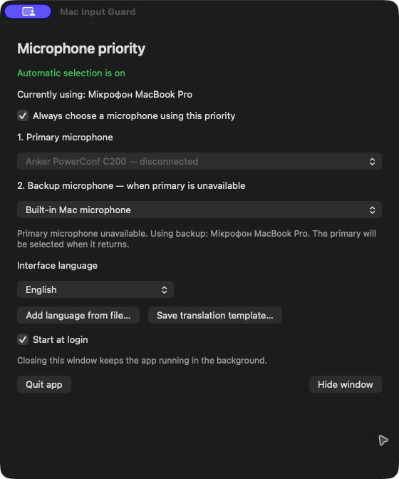

# Mac Input Guard

Залишай вбудований або USB-мікрофон основним, навіть коли користуєшся Bluetooth-навушниками чи колонкою.

[English](README.md) · [Завантажити програму](https://github.com/simplaerai-sv/mac-input-guard-app/releases/latest)

## Для чого з’явилася ця програма

Mac Input Guard створено через одну набридливу історію: macOS раз за разом перемикала типовий вхід на мікрофон Bluetooth-навушників або колонки. Замість бажаного вбудованого чи зовнішнього USB-мікрофона використовувався інший, і доводилося вручну повертати свій вибір.

Якщо якість Bluetooth-мікрофона тебе не влаштовує, таке перемикання впливає на дзвінки, зустрічі, записи й розпізнавання голосу. Програма тримає вибраний мікрофон основним: можна слухати через Bluetooth, а говорити через вбудований або USB-мікрофон.

Цей додаток присвячується всім, кого теж замучило постійне виправлення цієї настройки.

## Коли це корисно

- **Bluetooth-навушники для прослуховування, мікрофон ноутбука для голосу.** Звук залишається у навушниках, а типовим входом є вбудований мікрофон.
- **USB-мікрофон або камера на робочому столі.** Поки пристрій підключений — використовується він; після від’єднання — вбудований мікрофон. Після повернення USB-пристрою він знову стає основним.
- **Дзвінки, зустрічі, запис і диктування.** Потрібний мікрофон залишається вибраним, без непомітного переходу на небажаний вхід.
- **Часте підключення Bluetooth-пристроїв.** Не треба щоразу відкривати параметри звуку й повертати свій мікрофон.

## Скріншот

*Основна USB-камера від’єднана, тому використовується резервний вбудований мікрофон. Назви пристроїв надає macOS своєю мовою; інтерфейс програми англійський.*

## Як працює

Обери **основний** і **резервний** мікрофони. Коли основний USB-мікрофон від’єднано, програма вибирає резервний. Коли основний повертається, вона знову вибирає його. Якщо обидва обрані пристрої відсутні, останнім резервом є вбудований мікрофон Mac. Bluetooth-мікрофони не додаються до пріоритету.

Є звичайне вікно, іконка у верхній панелі, поточний стан, перемикач автоматичного вибору та автозапуск. Закриття вікна залишає програму працювати у фоні; **«Завершити програму»** зупиняє її.

Програма змінює лише системний типовий вхід. Якщо інша програма має власний вибір мікрофона, установи в ній **системний типовий вхід**. Mac Input Guard не записує звук, не змінює пристрій відтворення й не звертається до сервера.

## Встановлення

1. Завантаж `Mac-Input-Guard-1.5.0-universal.zip` із [Releases](https://github.com/simplaerai-sv/mac-input-guard-app/releases/latest).
2. Розпакуй і перенеси **Mac Input Guard.app** до папки **«Програми»**.
3. Відкрий програму, вибери основний і резервний мікрофони та залиш автоматичний вибір увімкненим.
4. За потреби ввімкни **«Запускати при вході в macOS»**. Програма сама створює свій автозапуск, без Термінала.

Потрібна **macOS 13 або новіша**. Пакет містить збірку для **Apple Silicon та Intel**. Функціональні перевірки виконано на Apple Silicon; запуск на фізичному Intel Mac ще не перевірено.

Ця версія має ad-hoc підпис, але **не має нотаризації Apple**. macOS може показати застереження для завантаженої програми. Перед відкриттям ознайомся з [інструкцією Apple](https://support.apple.com/uk-ua/guide/mac-help/mh40616/mac). До релізу додається контрольна сума SHA-256.

## Мови

Українська та англійська вже включені. Мову можна змінити у вікні програми. Для власного перекладу використай кнопку **«Додати мову з файла…»**.

Кнопка **«Зберегти шаблон перекладу…»** вивантажує готовий приклад зі всіма рядками та поясненням. Також є [готовий шаблон](translations/template.json) у репозиторії.

[Інструкція перекладу](TRANSLATIONS.md) · [Англійський шаблон](translations/en.json). Якщо у перекладі бракує рядка, використовується англійський текст. Переклад — локальний JSON-файл, без виконуваного коду.

Цей публічний репозиторій містить готові завантаження, інструкції та переклади. Вихідний код програми зберігається приватно. Про проблеми можна написати в [Issues](https://github.com/simplaerai-sv/mac-input-guard-app/issues).
